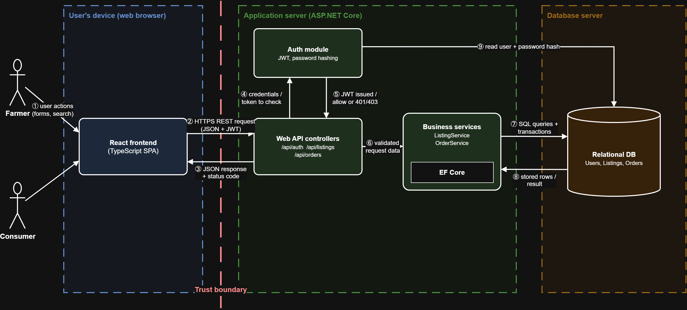

# CropTrader

A web-based marketplace that connects farmers directly with individual consumers.

## Project Description
Farmers often sell their products through several intermediaries before the products reach the consumer, and each step adds its own cost. As a result, farmers receive only a small part of what consumers pay, and consumers who want to buy directly from producers have few easy ways to find them. CropTrader aims to remove this gap by bringing farmers and consumers together on one simple platform.

## Target Users
- **Farmers:** small and medium-sized producers who want to sell their products directly and set their own prices.
- **Consumers:** individuals who want to buy fresh agricultural products directly from producers.

## Planned Features
| ID | Feature | Priority |
|----|---------|----------|
| FR-01 | Registration and login as a farmer or a consumer | Must |
| FR-02 | Creating product listings with price, quantity and location | Must |
| FR-03 | Browsing, searching and filtering listings | Must |
| FR-04 | Placing an order directly, with cash on delivery | Must |
| FR-05 | Automatic stock update after each order | Must |
| FR-06 | Order status tracking by the farmer | Should |

Full requirements, non-functional requirements and user stories: [docs/requirements.md](docs/requirements.md)

## Scope
**Included in the first version:** registration and login with two roles, product listings, search and filtering, direct ordering with cash on delivery, automatic stock update and order status tracking.

**Not included in the first version:** online payment, delivery and cargo tracking, price negotiation or bidding, a mobile application and AI-based price prediction. These are planned as future work.

## Architecture
CropTrader is a three-layer web application: a React single-page frontend in the browser, an ASP.NET Core Web API on the server (controllers, authentication with JWT, business services with Entity Framework Core) and a SQL Server database that only the API can reach.

Data model, API endpoints and design decisions: [component interfaces](docs/design/component-interfaces.md) · [design decisions](docs/design/design-decisions.md)

## Planned Technologies
- **Backend:** ASP.NET Core Web API (C#)
- **Frontend:** React with TypeScript
- **Database:** Microsoft SQL Server (LocalDB in development) with Entity Framework Core
- **Version control:** Git and GitHub

The reasons for these choices are recorded in [docs/design/design-decisions.md](docs/design/design-decisions.md).

## Current Status
Week 3 – Architecture and technical design. The architecture, the data model, the planned API endpoints and the main technology decisions are documented. Next step (Week 4): first working prototype with registration, login, creating a listing and searching listings.

## Documentation
- [Project description](docs/project-description.md)
- [Requirements](docs/requirements.md)
- [References](docs/references.md)
- [Design decisions](docs/design/design-decisions.md)
- [Component interfaces and API endpoints](docs/design/component-interfaces.md)
- [Week 3 progress](docs/weekly-progress/week03.md)
